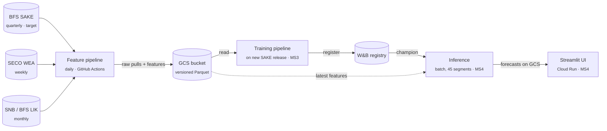

# Swiss Segmented Unemployment Rate Predictor

MLOps HS26 semester project (P04) — Hochschule Luzern

Forecasts Switzerland's ILO unemployment rate for the **next quarter**: the national total and 44 demographic
segments (gender × nationality × age group), 45 series in total. Between the quarterly releases the forecast is
refreshed as a nowcast from weekly and monthly economic indicators.

[Proposal (MS1)](docs/proposal.pdf) · [Decision log](docs/decisions.md) · [MS2 summary](docs/ms2_summary.pdf)

## Status

| Milestone | State |
|---|---|
| MS1 · Proposal | ✅ submitted, reviews answered in [`docs/ms2_summary.pdf`](docs/ms2_summary.pdf) |
| **MS2 · Feature pipeline** | ✅ live ingestion + backfill, leakage-checked features in a versioned feature store on GCS, scheduled daily |
| MS3 · Training pipeline | planned: pooled LightGBM, W&B tracking and registry, retrain on a new SAKE release |
| MS4 · Inference + UI | planned: batch forecasts for all 45 segments, deployed on Cloud Run |

**Where to look first (MS2):**
[`src/feature_pipeline/features.py`](src/feature_pipeline/features.py) builds the features and checks them for leakage ·
[`tests/test_features.py`](tests/test_features.py) proves it (`test_no_leakage_on_any_date`) ·
[`notebooks/02_feature_pipeline.ipynb`](notebooks/02_feature_pipeline.ipynb) explains every step with outputs ·
the **Actions** tab shows the scheduled runs.

## Architecture (FTI)



| Pipeline | Input → output | Trigger |
|---|---|---|
| **Feature** | SAKE, WEA, LIK → raw pulls, features and labels in the feature store | Daily schedule + manual |
| **Training** (MS3) | Features and labels → model in the registry | New SAKE release (new hash in the pull log) |
| **Inference** (MS4) | Latest features + champion model → forecasts for 45 segments on GCS, shown by a Streamlit app (D13) | After each feature refresh |

## Data

| Source | Role | Frequency | Access |
|--------|------|-----------|--------|
| BFS Labour Force Survey (SAKE): ILO unemployment rate by gender, nationality and age group | Target (label) and own history | Quarterly | opendata.swiss CKAN API, CSV resource |
| SECO Weekly Economic Activity (WEA), series `seco_wwa` | Nowcast feature | Weekly | CSV from SECO, no key |
| BFS consumer price index (LIK), year-on-year inflation `VVP` | Nowcast feature | Monthly | SNB data portal, cube `plkopr`, CSV, no key |

**Scope.** SAKE from 2010Q1, the first quarter with the full gender × nationality × age breakdown. The 65+ age group
is excluded. This gives the national total plus 44 segments, with no missing values.

**How it stays live.** SAKE changes once a quarter, so the forecast is a nowcast: new WEA values arrive weekly and
new LIK values monthly, and each refreshes the features. A new SAKE release will trigger retraining (D1, D4).

**Target.** The year-on-year change of the rate in the target quarter; the forecast is the same quarter last year
plus the predicted change, because SAKE is not seasonally adjusted (D6). Success target: at least 15 % lower MAE than
the seasonal-naive baseline on the 28 reliable segments (D10).

**Change from the MS1 proposal.** The proposal used SAKE with a quarterly CPI covariate only. After the MS1 reviews
(editorial point E1) WEA was added and CPI switched to monthly LIK. See [`docs/decisions.md`](docs/decisions.md).

## Feature store

A "versioned Parquet on GCS" feature store, in one bucket:

```
raw/pull_log.csv                                     every pull: download date, SHA-256, release date, file
raw/<sake|wea|lik>/<download date>.csv               the raw file, stored only when its content changed
feature_store/features/version=<run date>/
    features.parquet                                 one row per segment and as-of date, features + labels
    manifest.json                                    source hashes, git commit, lags, columns
```

Each run recomputes the full **backfill** (one row set per SAKE release since 2011Q1, the training data) and adds
**refresh** rows as of the run date (the newest nowcast). Every row is computed only from values that were
published by its `as_of` date (point-in-time correct, D7); the pipeline stops before writing if a check fails.

| Group | Columns |
|---|---|
| Keys | `as_of`, `kind` (release / refresh), `segment`, `quarter_t`, `target_quarter` |
| Segment | `gender`, `nationality`, `age_group`, `target_qoy` |
| Own history | `rate_t`, `rate_t1`, `rate_t3`, `yoy_t`, `status_t` (BFS reliability code) |
| WEA | `wea_13w`, `wea_q1` … `wea_q4` |
| Inflation | `lik_latest`, `lik_q1` … `lik_q4` |
| Labels | `y_rate`, `y_yoy` (empty for the quarter still to forecast) |

Read it with `src.common.feature_store.load_features(store, version=None)`, the latest version by default.

## Run it

Requires [uv](https://docs.astral.sh/uv/). Python 3.14 and all packages come from `uv.lock`.

```bash
git clone https://github.com/theodorahaimoff/HSLU_HS26_MLOPS.git
cd HSLU_HS26_MLOPS
uv sync --locked                     # exact versions from uv.lock
uv run pytest                        # unit tests, offline, a few seconds
uv run ruff check                    # lint
```

**Feature pipeline**

```bash
uv run python -m src.feature_pipeline.run              # live sources; writes to GCS if GCS_BUCKET is set, else to data/
uv run python -m src.feature_pipeline.run --offline    # snapshots in data/raw/exploration (from notebook 01), writes to data/
uv run python -m src.training_pipeline.baselines       # MAE of the two naive baselines on the latest version (B2)
```

To write to the bucket, copy `.env.example` to `.env` and fill in `GCS_BUCKET` and the path to a service-account
key with access to that bucket only. `.env` and key files are gitignored and excluded from the Docker build context.

**Docker**

```bash
docker build -t unemployment-features --build-arg GIT_COMMIT=$(git rev-parse HEAD) .
docker run --rm \
  -e GCS_BUCKET=<bucket> \
  -e GOOGLE_APPLICATION_CREDENTIALS=/run/secrets/gcp-key.json \
  -v "$PWD/gcp-key.json:/run/secrets/gcp-key.json:ro" \
  unemployment-features
```

The image (`python:3.14-slim`, uv pinned, non-root user 1001) contains only the locked runtime dependencies and
`src/`; credentials are passed in at run time. Without `GCS_BUCKET` it writes inside the container.

## Automation

| Workflow | Trigger | What it does |
|---|---|---|
| [`ci.yml`](.github/workflows/ci.yml) | Every push and pull request | `uv sync --locked`, ruff, pytest, Docker build + smoke test |
| [`feature_pipeline.yml`](.github/workflows/feature_pipeline.yml) | Daily 05:17 UTC + manual | Tests, then the live feature pipeline against the bucket |

Secrets live in GitHub repository secrets (`GCP_KEY_JSON`, `GCS_BUCKET`), never in the repository.

## Repository layout

```
.github/workflows/      ci.yml, feature_pipeline.yml
docs/                   proposal.pdf, decisions.md, ms2_summary.pdf
notebooks/              01 data exploration, 02 feature pipeline (documented with outputs)
src/
├── common/             config (.env, repo root, git commit), storage (GCS / local), feature store
├── feature_pipeline/   sources (pull, parse, validate), pull_log, features (build, backfill, checks), run
├── training_pipeline/  baselines (B2); training follows in MS3
└── inference_pipeline/ MS4
tests/                  unit tests on small synthetic files, no network or credentials needed
Dockerfile · .dockerignore · pyproject.toml · uv.lock · .env.example
```
